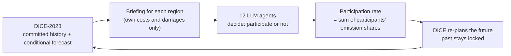

# Fragile Cooperation: Climate Treaty Participation with LLM-Driven Regional Agents

This project studies why world regions join, leave, or rejoin a climate agreement, and how those choices change global emissions, carbon prices, and warming. It couples two models in a closed loop:

- **DICE-2023**, the integrated climate-economy model of Barrage and Nordhaus (2024), handles the global economy, emissions, temperature, carbon price, and the social cost of carbon (SCC).
- **An agent-based model (ABM)** with 12 regional agents, one for each RICE-2010 region. A large language model (LLM) drives each agent through Google DeepMind's Concordia framework.

This is a mechanism simulation. It asks how cooperation can erode and recover under different information and interaction rules. It does not predict what real countries will do.

> **Status:** in progress (2026). The source code is in a private repository and is available on request.

## Research Questions

| | Question |
|---|---|
| RQ1 | Do agent decisions and stated reasons respond to regional characteristics and to the information they receive? |
| RQ2 | How do exit, rejoining, erosion, and recovery of cooperation change emissions, carbon prices, the SCC, and warming? |
| RQ3 | How do roundtable discussion, public commitments, and small-group negotiation change participation, compared with independent decisions? |

## How the Loop Works

Every five years (2025, 2030, ...), the two models exchange information:

In 2020, all regions participate. For each later period, each agent reads a briefing, reasons in three public steps (situation, regional interest, intention), and then votes. The program adds up the emission shares of the regions that vote "participate". DICE then re-optimizes the future with this participation rate. Emissions, capital, and temperature that already happened cannot change.

## What I Built

### 1. Rolling DICE-2023 with Partial Participation

I extended the Python implementation of DICE-2023 (by Huasheng Nie and Ivo Welch, based on the original DICE code):

- **Period-by-period re-planning.** The model takes one participation decision at a time. It locks all committed history and checks that each new solution replays the past exactly.
- **Partial participation.** Only participants abate. The model handles edge cases such as zero participation and later rejoining.
- **Carbon-cycle fix.** Under long-run low participation, the original Python carbon cycle ignored failed root-finding and produced invalid values. I added residual checks and adopted the saturation rule from the FaIR model (Millar et al., 2017, Section 2.2), which caps the 100-year integrated impulse response at 96.6 years.
- **Checkpoints.** Runs save to JSON and resume with full history verification.
- **Participation experiments.** Scripts compare the SCC, carbon price, and temperature under fixed participation levels and under participation paths that decline over time.

### 2. LLM Agent-Based Model

- **12 regional agents** built from real Concordia components, each with its own memory and a regional profile (persona).
- **Information control.** Each agent sees only its own profile, its own costs and damages, and the shared global history. It never sees other regions' votes or reasons from the same round.
- **Memory with redaction.** After each vote, an extra LLM call selects which of the agent's own sentences to keep. The step deletes sentences that cite forecasts or other regions' information. The model can only keep original sentences; it cannot rewrite them.
- **Interaction modes.** Independent decisions are the main condition. An optional Game Master mode adds a roundtable of all regions and small-group negotiations started by a region.
- **Model adapters** for Gemini, DeepSeek, and OpenAI APIs.

### 3. Regional Accounting

DICE is a single-region model, so I added a layer that splits global results into regional costs and damages for the briefings:

- Participation weights come from 2019 fossil CO2 emissions.
- Regional GDP comes from 2019 PPP GDP shares (World Bank WDI).
- Participants share abatement costs in proportion to their emissions.
- Regional damages use RICE-2010 damage coefficients, normalized to the DICE global damage. A control condition gives every region the same damage-to-GDP ratio.
- The code checks that regional sums always equal the global totals.

### 4. Research Materials

- A shared background text, a set of decision rules, and a profile (persona) card for each region, drafted with source documentation and review records.
- A clean-energy data extension (renewable generation and employment by region), prepared for the regional profiles.

### 5. Reproducibility and Testing

- About 400 automated tests across the DICE and ABM code.
- Offline "engineering" runs replace the LLM with preset answers and use the real DICE solver. These runs check the full loop, including exit and rejoin scenarios, before any paid API call.
- Each round commits as a whole. A failed round rolls back; a failure never counts as an exit. Runs record input hashes, source-code snapshots, prompts, option order, and token usage, and can resume from the last committed round.

## Current Progress

- Rolling DICE with partial participation: done and validated.
- Closed DICE-ABM loop: runs end to end offline, including save and resume.
- First pilot with a real LLM (two five-year rounds): done. Its review led to revisions of the memory step and the intention prompt, now in preparation.
- Next: full independent-decision experiments, then the roundtable and small-group conditions, repeated runs, and a paper.

## Tools

Python · DICE-2023 (Python) · Google DeepMind Concordia · LLM APIs (DeepSeek, Gemini, OpenAI) · NumPy / SciPy

## References

- Barrage, L., and Nordhaus, W. (2024). Policies, projections, and the social cost of carbon: Results from the DICE-2023 model. *PNAS*, 121. https://doi.org/10.1073/pnas.2312030121
- Millar, R. J., et al. (2017). A modified impulse-response representation of the global near-surface air temperature and atmospheric concentration response to carbon dioxide emissions. *Atmospheric Chemistry and Physics*, 17. https://doi.org/10.5194/acp-17-7213-2017
- Vezhnevets, A. S., et al. (2023). Generative agent-based modeling with actions grounded in physical, social, or digital space using Concordia. arXiv:2312.03664.
